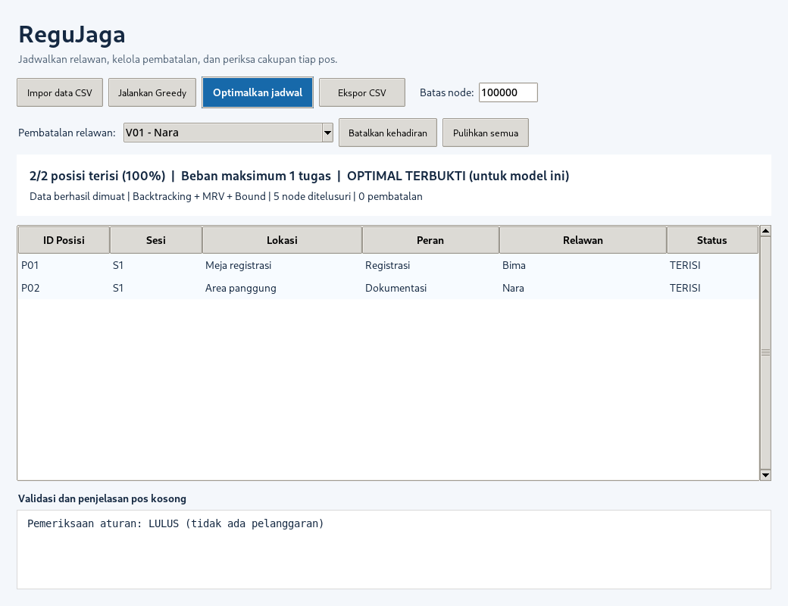

# ReguJaga

**Penjadwalan relawan otomatis yang transparan, dapat diverifikasi, dan dapat diperbaiki setelah pembatalan.**



Proyek kelompok Dasar-Dasar Pemrograman 1 (CSGE601020), Fakultas Ilmu Komputer, Universitas Indonesia — Semester Gasal 2026/2027.

> **Status:** MVP (minimum viable product) untuk **satu acara, data CSV lokal, slot waktu tidak saling beririsan**. Data pada `data/demo/` adalah **sintetis/fiktif**, bukan hasil validasi lapangan. Implementasi **dibantu AI**; seluruh anggota harus mereviu dan memahami kode sendiri.

## Masalah

Koordinator kegiatan biasanya perlu mengisi beberapa pos acara dengan relawan yang (1) tersedia pada slot tersebut, (2) mampu mengerjakan peran yang diminta, (3) tidak ditempatkan dua kali pada waktu yang sama, dan (4) tidak melebihi batas tugas. Saat ada pembatalan, satu solusi awal mungkin tidak lagi valid.

ReguJaga menyusun penempatan yang sah, menjelaskan posisi kosong, serta membandingkan metode greedy dengan pencarian berkendala (*Constraint Satisfaction Problem*). Aplikasi **tidak** menjanjikan solusi penuh apabila kendala memang membuatnya tidak mungkin.

## Fitur yang tersedia

- Impor `volunteers.csv` dan `positions.csv`; pemeriksaan header, ID ganda, dan kolom invalid.
- Algoritma **greedy baseline** dengan urutan masukan tetap (untuk pembanding).
- Algoritma **backtracking + MRV + branch-and-bound** untuk memaksimalkan jumlah posisi terisi, lalu meminimalkan beban maksimum.
- Pembatalan relawan dan penghitungan ulang otomatis; tombol pulihkan semua.
- Validasi hasil terpisah dari algoritma, keterangan posisi kosong, jumlah node, dan status optimalitas.
- Ekspor hasil CSV yang dapat dibuka di Excel/Sheets.
- Tiga set data contoh serta pengujian otomatis, termasuk pembanding exhaustive untuk data kecil.

## Prasyarat

- **Python 3.10 atau lebih baru**.
- `tkinter`, biasanya tersedia pada instalasi Python Windows resmi. Di sejumlah distro Linux perlu paket OS `python3-tk`.
- **Tidak** perlu internet, akun, database, API, atau instalasi paket Python tambahan untuk menjalankan aplikasi.

## Cara menjalankan (Windows / macOS / Linux)

1. Download atau clone repo dan buka folder `ReguJaga-DDP1`.
2. Buka terminal pada folder tersebut.
3. Jalankan:

```bash
python run.py
```

Pada beberapa perangkat Windows gunakan `py run.py`; pada macOS/Linux bisa `python3 run.py`.

**Jalankan pengujian:**

```bash
python -m unittest discover -s tests -v
```

**Alternatif untuk menjalankan dari modul terpasang (opsional):**

```bash
python -m pip install -e .
python -m regujaga.app
```

## Menjalankan dari Windows tanpa mengetik perintah

- Klik dua kali **`JALANKAN_WINDOWS.bat`** untuk membuka aplikasi (Python 3.10+ harus terpasang).
- Klik dua kali **`UJI_WINDOWS.bat`** untuk menjalankan seluruh pengujian dan melihat hasilnya.
- Jika Tkinter tidak tersedia atau komputer tidak punya tampilan desktop, jalankan versi terminal dengan `python demo.py`.

**Contoh demo terminal:**

```bash
python demo.py                           # Kasus greedy dibanding solver
python demo.py --cancel V02              # Bima membatalkan
python demo.py --scenario 3              # Kasus tidak semua posisi bisa terisi
python demo.py --limit 0                 # Solusi awal belum terbukti optimal
python demo.py --export output/jadwal.csv
```

## Demo 90 detik

1. Jalankan `python run.py` (contoh kasus `01_jebakan_greedy` dimuat otomatis).
2. Klik **Jalankan Greedy**. Hasil: **1/2** posisi terisi.
3. Klik **Optimalkan jadwal**. Hasil: **2/2** posisi terisi. Bima menangani Registrasi, Nara menangani Dokumentasi.
4. Pilih **V02 - Bima**, kemudian klik **Batalkan kehadiran**. Hasil: **1/2** posisi terisi; satu posisi tetap kosong dan diberi keterangan.
5. Klik **Pulihkan semua**; hasil kembali **2/2**. Klik **Ekspor CSV**.

Lihat [Panduan Demo](docs/SKENARIO_DEMO.md) untuk percakapan presentasi dan kasus tambahan. Baca juga [Peta Pemahaman Kode](docs/PETA_PEMAHAMAN_KODE.md) dan [Rencana Kerja](docs/RENCANA_KERJA.md) untuk pembagian pekerjaan nyata.

## Format data input

**`volunteers.csv`** (kolom wajib):

```csv
id,name,roles,available_slots,max_tasks
V01,Nara,Registrasi;Dokumentasi,S1,1
V02,Bima,Registrasi,S1,1
```

**`positions.csv`** (kolom wajib):

```csv
id,slot,role,location
P01,S1,Registrasi,Meja registrasi
P02,S1,Dokumentasi,Area panggung
```

Tanda `;` memisahkan banyak peran/slot dalam **satu sel CSV**. Nama peran dan slot dicocokkan **persis**, termasuk huruf besar/kecil. ID harus unik. Satu kebutuhan 2 orang = 2 baris posisi yang berbeda. Semua slot pada MVP dianggap unit waktu berbeda **tanpa saling overlap** (mis. `S1`, `S2`); jangan gunakan waktu tumpang tindih dengan nama slot berbeda.

## Cara kerja algoritma

1. Validasi data dan bentuk posisi/relawan sebagai objek Python.
2. Bangun solusi awal menggunakan greedy. Hasil ini dipakai juga sebagai *incumbent* untuk menjaga solusi parsial valid bila pencarian dibatasi.
3. Pada tiap langkah, pilih posisi **MRV (Minimum Remaining Values)**: posisi yang saat ini punya kandidat sah paling sedikit.
4. Coba relawan sah, diurutkan berdasarkan beban sementara paling rendah dan ID stabil; jika belum ada solusi penuh, izinkan cabang posisi kosong.
5. Batalkan pilihan sementara (*backtrack*) setelah menelusuri cabang.
6. **Bound:** pangkas jika jumlah posisi saat ini yang telah terisi ditambah semua posisi tersisa tidak dapat mengalahkan cakupan terbaik.
7. Pilih solusi berdasarkan prioritas: **cakupan maksimum → beban maksimum minimum → ID relawan stabil**.
8. Bila jumlah node mencapai batas, hentikan dan laporkan hasil terbaik ditemukan sebagai **BELUM TERBUKTI OPTIMAL**.

> Klaim optimal hanya berlaku untuk **model dan data yang diberikan**, bukan seluruh persoalan penjadwalan dunia nyata. Pencarian eksponensial; sekitar `(jumlah relawan + 1) ^ jumlah posisi` kemungkinan kasar sebelum pruning.

Selengkapnya: [Algoritma dan Kendala](docs/ALGORITMA_DAN_KENDALA.md).

## Struktur proyek

```text
ReguJaga-DDP1/
├── run.py                  # Aplikasi GUI dimulai di sini
├── demo.py                 # Aplikasi terminal / pengujian cepat
├── JALANKAN_WINDOWS.bat    # Pembuka GUI Windows
├── UJI_WINDOWS.bat         # Pengujian Windows
├── src/regujaga/
│   ├── app.py              # Tk mainloop
│   ├── ui.py               # Antarmuka pengguna
│   ├── models.py           # Volunteer, Position, ScheduleResult
│   ├── csv_io.py           # Impor, ekspor, validasi berkas
│   ├── rules.py            # Verifier dan aturan keras
│   ├── baseline.py         # Greedy pembanding
│   └── solver.py           # Backtracking + MRV + bound
├── data/demo/              # 3 skenario sintetik
├── tests/                  # Pengujian unittest
├── docs/                   # Kontrak, demo, riset pengguna, GitHub
├── .github/workflows/      # CI saat repo dipublikasikan
├── .github/ISSUE_TEMPLATE/ # Formulir pekerjaan kelompok
├── CONTRIBUTING.md         # Ketentuan PR/commit asli
└── .gitignore
```

## Pengujian

Perintah `python -m unittest discover -s tests -v` mencakup:

- hasil greedy vs solver pada kasus jebakan;
- pembatalan, posisi tidak mungkin diisi, kasus kosong;
- bentrok slot dan batas tugas;
- input salah, ID ganda, CSV dengan BOM;
- *node budget* kecil dan label solusi tidak optimal;
- pemeriksaan solver dengan **enumerasi exhaustive independen** untuk puluhan kasus kecil acak ber-*seed* tetap.

Hasil pengujian pada lingkungan penyusunan: **31 unit test lulus**. UI telah diuji dengan skenario impor otomatis, pembatalan, dan pemulihan. Setiap anggota tetap harus menjalankan ulang pada komputernya.

## Keterbatasan

1. Satu acara, satu jenis pekerjaan per posisi, dan slot diskret yang tidak overlap. Belum mendukung jam parsial, durasi, lokasi yang saling berjauhan, atau batas istirahat.
2. **Tidak ada** akun, aplikasi web, notifikasi, atau database. Ini keputusan pembatasan lingkup, bukan fitur yang rusak.
3. Hasil optimal **tidak dijamin** apabila batas node tercapai; hasil tetap sah dan disertai status.
4. Kebijakan 'adil' hanya berarti menekan **beban maksimum** di antara solusi dengan cakupan sama; belum mengukur preferensi atau lama kerja.
5. Pembatalan mengoptimalkan ulang tanpa mengutamakan jumlah perubahan dari jadwal awal.
6. Pada data nyata, klaim manfaat memerlukan contoh roster anonim berizin dan umpan balik koordinator.

## Kontribusi dan keaslian riwayat Git

Setiap anggota kelompok **harus berkontribusi sungguhan**. Awali pembagian dengan [rencana kerja](docs/RENCANA_KERJA.md), lalu ikuti [CONTRIBUTING](CONTRIBUTING.md). Jangan membuat commit palsu, memakai identitas anggota lain, atau melakukan squash seluruh kontribusi ke satu akun. Rekomendasi pembagian dan perintah tersedia di [Panduan GitHub](docs/PANDUAN_GITHUB.md).

> Ketentuan resmi DDP1: repositori **publik**, video YouTube **maksimal 15 menit**, kontribusi aktif seluruh anggota, tenggat **10 Desember 2026 23.59 WIB**. Sesuaikan rancangan dengan masukan asdos.

## Validasi manfaat di lapangan

Sebelum mengklaim aplikasi sudah menyelesaikan masalah nyata, lakukan wawancara/uji satu koordinator dan isi [Lembar Validasi](docs/VALIDASI_PENGGUNA.md). Catat waktu penyusunan manual vs aplikasi, jumlah posisi terisi, serta keterbatasan. Tanpa bukti, hasil ini adalah demonstrasi teknis dengan data sintetik.

## Referensi

- Panduan Proyek Kelompok DDP1 Semester Gasal 2026/2027 (berkas perkuliahan yang disediakan pengguna).
- Riset 15 Ide Proyek DDP1 UI, Bagian 5, 7, 9–11 (berkas kajian yang disediakan pengguna).
- Python `csv`: https://docs.python.org/3/library/csv.html
- Python `tkinter`: https://docs.python.org/3/library/tkinter.html
- Python `unittest`: https://docs.python.org/3/library/unittest.html
- GitHub Docs: https://docs.github.com/en/repositories/creating-and-managing-repositories/creating-a-new-repository

## Membuat repositori GitHub publik (akun farizzz316)

**Repositori GitHub tidak otomatis ada hanya karena folder ini disiapkan.** Publikasikan secara nyata dengan skrip berikut, dijalankan oleh pemilik akun GitHub.

1. Pasang Git (`https://git-scm.com/download/win`) dan GitHub CLI (`https://cli.github.com/`); Windows dapat memakai `winget install --id GitHub.cli --exact`.
2. Siapkan nama dan email commit yang benar menggunakan `git config --global user.name "Nama Asli"` dan `git config --global user.email "email-akun-github"`. Pakai alamat *noreply* GitHub jika tidak ingin mengekspos email pribadi.
3. **Windows:** klik dua kali `TERBITKAN_GITHUB_WINDOWS.bat`. **macOS/Linux:** jalankan `bash TERBITKAN_GITHUB_MAC_LINUX.sh`.
4. Login GitHub melalui browser jika diminta. Skrip memeriksa bahwa akun yang login adalah `farizzz316` sebelum membuat repositori publik `regujaga-ddp1` dan mengunggah commit awal.
5. Pastikan hasilnya mencantumkan `PUBLIC` dan buka `https://github.com/farizzz316/regujaga-ddp1`. Undang anggota kelompok di **Settings → Collaborators**. Setiap anggota wajib berkontribusi secara nyata; skrip ini hanya membuat commit awal dari komputer pemilik proyek.

Jika repositori sudah ada, skrip akan mengunggah commit lokal ke sana, tanpa mengganti alamat `origin` yang tidak sesuai.
